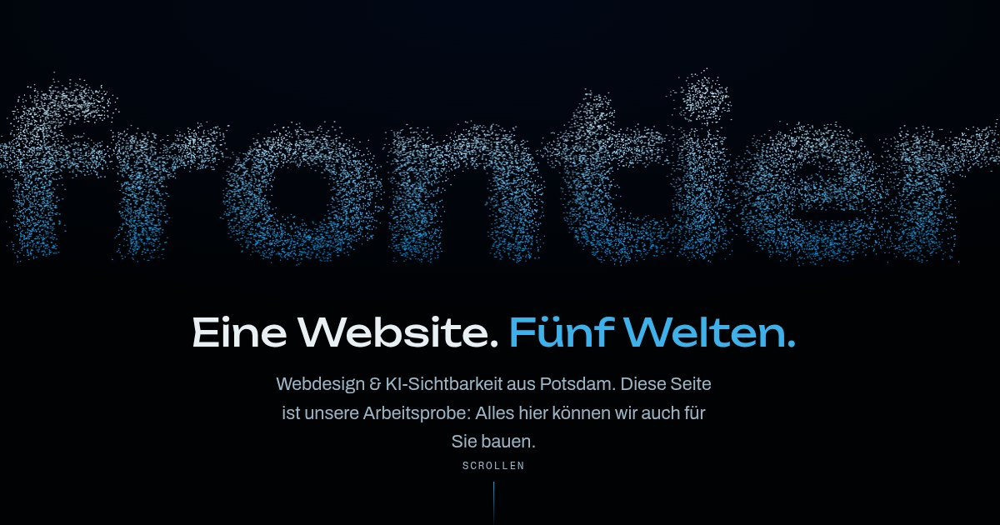

# frontier-design — Entwurf

Entwurf: Design-Vorschau von frontier-design, keine echte Unternehmenswebsite.

Status: prototype. Ein Entwurf zum Ansehen; nichts darin ist zugesagt, und Inhalte können sich jederzeit ändern.

**Entwurf / Design-Vorschau. Keine echte Unternehmenswebsite.** frontier-design ist noch nicht gestartet; Angebote, Preise und Angaben sind Platzhalter.

Dieses Repository enthält nur den fertig gebauten Stand der Website und stellt ihn über GitHub Pages bereit, damit der Entwurf unter einem Link angesehen werden kann. Suchmaschinen sind ausgeschlossen (`noindex`, `robots.txt`).



Vorschau: https://frontierdsgn.github.io/frontier-design-entwurf/

Gebaut aus dem privaten Repo `frontier-design`, Branch `main`, mit `ENTWURF=1 npm run build` in `site/`; die Befehle zum Veröffentlichen stehen dort im README-Abschnitt „Draft preview“. Der gebaute Commit steht in der Nachricht des jeweiligen Build-Commits (`git log`).

## Lokal ansehen

```sh
python3 -m http.server 8000 --bind 127.0.0.1
```

Dann http://127.0.0.1:8000/ öffnen. Vor jedem Commit `scripts/gate` ausführen (braucht `gitleaks`, installierbar mit `scripts/install-gitleaks`).

## Lizenz

Code (HTML-Markup, CSS, eigenes JavaScript, Skripte) unter der [MIT-Lizenz](LICENSE); Texte und Bilder der Website unter [CC BY 4.0](LICENSE-content). Mitgelieferte Werke Dritter behalten ihre eigenen Lizenzen: die Schriften unter der SIL Open Font License 1.1, GSAP unter seiner eigenen Lizenz, Lenis und three.js unter MIT. Die Einzelheiten stehen in [NOTICE](NOTICE).
